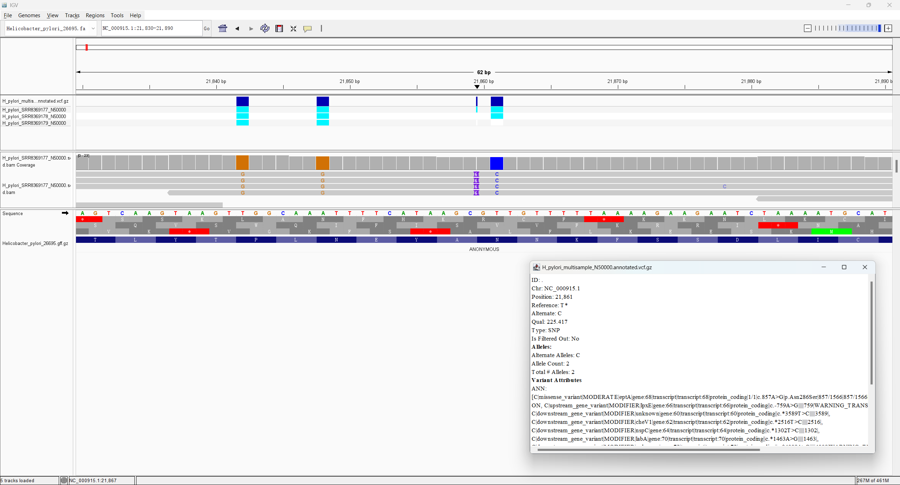

# Week 8: Predict Variant Effects

This assignment extends the Week 7 single-sample VCF to a multisample VCF and predicts the effects of coding variants in _Helicobacter pylori_.

## Samples and sequencing runs

The assignment asks for at least three samples in one multisample VCF. In SRA,
an `SRR` accession identifies a sequencing run. A biological sample can have
one run or several runs, so a run is not automatically the same thing as an
independent biological sample. In this analysis, each selected run represents
one independent _H. pylori_ isolate, which gives three different biological
genome backgrounds:

| Biological sample used here | SRA run | Why it was included |
|---|---|---|
| `H_pylori_SRR12829274_N50000` | `SRR12829274` | The Week 7 sample; it already produced a useful BAM and VCF. |
| `H_pylori_SRR8369179_N50000` | `SRR8369179` | An independent _H. pylori_ WGS isolate, used to add a second genome background. |
| `H_pylori_SRR27606652_N50000` | `SRR27606652` | Another independent paired-end _H. pylori_ WGS isolate, used to make the comparison multisample. |

The Week 5 BAM was not used because it was made from a very small transcriptomic read subset and had poor genome-wide coverage. I also did not count three runs from the same biological sample as three samples: that would increase sequencing data but would not add independent biological information. These three runs were selected because they are genomic DNA, paired-end Illumina WGS data from _H. pylori_. They are different isolates, so differences from the 26695 reference are expected. They should not be interpreted as biological replicates of one experimental condition.

If the same biological sample had multiple sequencing runs, I would combine the
reads from those runs before alignment and variant calling, producing one BAM
and one genotype for that sample. I would not put those technical runs into
the multisample VCF as separate biological samples. Here, each run is used as
one sample because the metadata identify the runs as independent _H. pylori_
isolates rather than repeat sequencing of one isolate.

The workflow uses `N=50000` read spots per run. This keeps the download and computation practical while giving each sample more information than the old Week 5 BAM. Change the value reproducibly with `make N=100000` if more depth is needed.

## Software choice

I used `bcftools` for both the multisample VCF operations and effect prediction:

- `bcftools merge` combines the three single-sample VCFs while preserving sample names and genotypes.
- `bcftools csq` predicts coding consequences using the local reference FASTA and the matching NCBI GFF3 annotation.

This choice is appropriate here because the reference, GFF, contig name (`NC_000915.1`), and VCF were all produced for the same _H. pylori_ 26695 assembly. `bcftools csq` is already available in the course environment, so no new installation or external annotation database is required. `SnpEff` would also be a reasonable annotator, but it is not installed in the course environment and would require building or locating a compatible custom _H. pylori_ database. `VEP` and `ANNOVAR` are powerful, but their commonly packaged databases are mainly human-focused; using them without a verified custom database could give misleading annotations for this bacterial genome.

The NCBI GFF contains CDS features attached directly to genes, whereas `bcftools csq` expects a transcript-to-CDS hierarchy. The Makefile therefore creates `annotation/Helicobacter_pylori_26695.csq.gff3` from the same NCBI GFF. This is a format conversion, not a new annotation source: coordinates, strand, phase, and CDS sequence are retained.

## Reproduce the analysis

```bash
pixi run -m "$HOME/edu/bioinfo" make -C week08 all
```

The Makefile performs the following steps for each sample:

1. Download the same-size paired-end read subset from SRA.
2. Trim reads with `fastp`.
3. Align reads to the Week 2 _H. pylori_ 26695 reference with `bwa mem`.
4. Sort and index each BAM with `samtools`.
5. Call haploid variants with `bcftools mpileup` and `bcftools call --ploidy 1`.
6. Merge the three VCFs with `bcftools merge`.
7. Predict coding effects with `bcftools csq` using NCBI genetic code 11 from the GFF annotation.

Main outputs:

```text
vcf/H_pylori_multisample_N50000.vcf.gz
vcf/H_pylori_multisample_N50000.annotated.vcf.gz
reports/sample_summary.tsv
reports/effect_summary.tsv
```

The final VCF contains three named isolate samples. In this run, the numbers of called
sites were 193 for `SRR12829274`, 72,510 for `SRR8369179`, and 64,706 for
`SRR27606652`. The counts differ because the isolates have different sequence
differences relative to the 26695 reference and because the same read subset
does not give identical coverage in every genome. The effect summary contains
62,709 synonymous, 29,960 missense, 153 frameshift, 73 in-frame deletion, 84
in-frame insertion, 60 stop-gained, 69 stop-lost, and 30 start-lost
annotations. These are annotation counts, not counts of experimentally
validated functional changes.

## Interpreting the annotations

The annotated VCF stores predicted consequences in the `BCSQ` INFO field. The important categories include:

- `missense`: a coding change that changes one amino acid.
- `synonymous`: a coding change that does not change the amino acid.
- `stop_gained`: a change that creates a premature stop codon.
- `frameshift`: an insertion or deletion that changes the reading frame.

These are predictions relative to the 26695 reference, not experimental measurements of protein function. A nonsynonymous or frameshift call should be checked in IGV and interpreted with its read depth, mapping quality, allele support, and location in the gene.

For each example selected from `BCSQ`, I record:

1. the chromosome and position;
2. the gene and coding feature;
3. the reference and alternate codons;
4. the predicted amino-acid change;
5. the samples carrying the alternate allele;
6. whether the BAM reads support the call.

The codon and amino-acid change must be copied from the actual annotated VCF produced by the Makefile. This avoids guessing from the forward genomic strand when a gene is on the reverse strand.

## IGV evidence

For one selected coding variant, load the following in IGV:

1. `../week02/fasta/Helicobacter_pylori_26695.fa`
2. one or more BAM files from `bam/`
3. `vcf/H_pylori_multisample_N50000.annotated.vcf.gz`
4. `../week02/gff/Helicobacter_pylori_26695.gff.gz`

Zoom until the nucleotide sequence, translated coding track, VCF marker, and individual reads are visible. The screenshot should show the exact coordinate in the IGV window and should include the variant popup or enough of the translated track to connect the VCF position to the coding sequence. A wide genome view is not sufficient evidence for a codon change.



The screenshot and the table below should describe the same variant. The screenshot is evidence that the call is aligned with a coding feature; the VCF annotation supplies the codon and amino-acid prediction.

## Results table

The following examples are from the actual `BCSQ` output:

| Coordinate | Gene | Reference codon | Alternate codon | Amino-acid change | Samples with ALT | Effect |
|---|---|---|---|---|---|---|
| `NC_000915.1:555` | `nusB` | `AAA` | `GAA` | Lys27Glu (`K27E`) | `SRR27606652` | missense |
| `NC_000915.1:639` | `ribH` | `GGT` | `GAT` | Gly156Asp (`G156D`) | `SRR8369179` | missense |

The codons in this table are written in the coding direction. Both genes are on the reverse strand, so the genomic reference and alternate bases must be reverse-complemented before forming the codons. The amino-acid changes and gene names come from the `BCSQ` field; the codons were checked against the reference FASTA and the CDS strand.

Do not call a variant a confirmed functional mutation based only on this workflow. The results are reference-relative predictions supported by short-read alignments.
