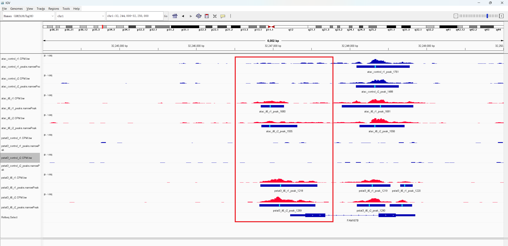
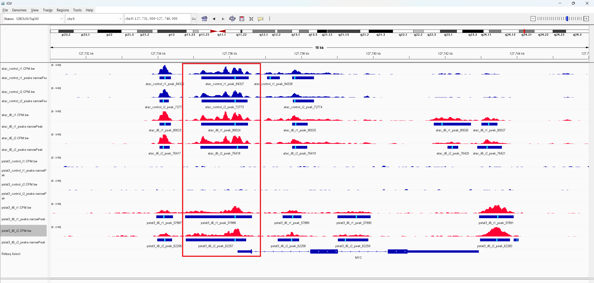
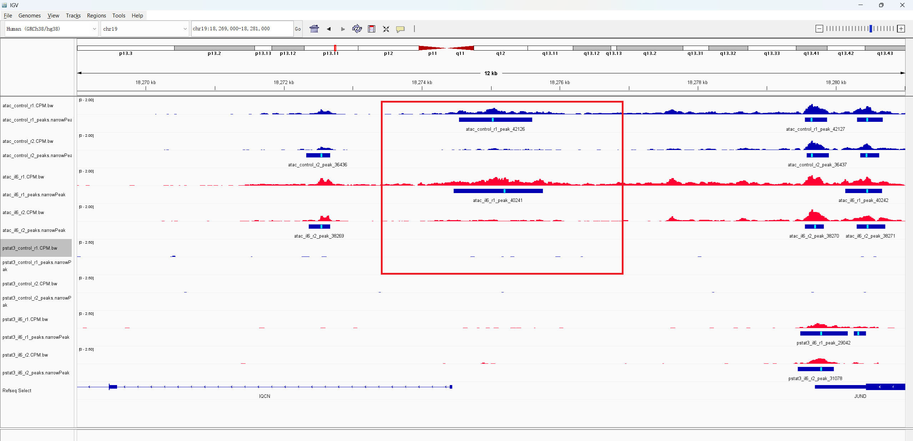

# IL6-associated pSTAT3 binding and chromatin accessibility

Siersbæk et al. reported that IL6/STAT3 signaling remodels a subset of
regulatory regions in T47D breast cancer cells. This analysis tests a limited
part of that result: whether IL6 increases pSTAT3 chromatin occupancy, and
whether the gained pSTAT3 peaks occur in regions that were already accessible
or became accessible following IL6 treatment.

## Data and design

The analysis uses hg38 and two biological replicates per assay and condition.
ATAC-seq samples come from [GSE150131](https://www.ncbi.nlm.nih.gov/geo/query/acc.cgi?acc=GSE150131),
and pSTAT3 ChIP-seq and Input DNA samples come from
[GSE126004](https://www.ncbi.nlm.nih.gov/geo/query/acc.cgi?acc=GSE126004).

| Sample | GEO sample | Assay | Condition | SRA runs |
|---|---|---|---|---|
| `atac_control_r1` | GSM4524017 | ATAC | Control | SRR11735697 |
| `atac_control_r2` | GSM4524021 | ATAC | Control | SRR11735701 |
| `atac_il6_r1` | GSM4524018 | ATAC | IL6 | SRR11735698 |
| `atac_il6_r2` | GSM4524022 | ATAC | IL6 | SRR11735702 |
| `pstat3_control_r1` | GSM3587801 | pSTAT3 | Control | SRR8520836–SRR8520838 |
| `pstat3_control_r2` | GSM3587805 | pSTAT3 | Control | SRR8520848–SRR8520850 |
| `pstat3_il6_r1` | GSM3587802 | pSTAT3 | IL6 | SRR8520839–SRR8520841 |
| `pstat3_il6_r2` | GSM3587806 | pSTAT3 | IL6 | SRR8520851–SRR8520853 |
| `input_control` | GSM3587833 | Input | Control | SRR8520932–SRR8520937 |
| `input_il6` | GSM3587835 | Input | IL6 | SRR8520944–SRR8520949 |

ATAC-seq is paired-end; ChIP-seq and Input DNA are single-end. Multiple SRA
runs from the same GSM are merged before alignment and remain one biological
sample. The machine-readable sample mapping and ChIP/Input pairing are in
[`design.csv`](design.csv).

## Reproducing the analysis

The isolated Pixi environment records all command-line dependencies in
`pixi.toml` and `pixi.lock`. The completed analysis used Bowtie2 2.5.5,
SAMtools 1.25, MACS3 3.1.0, BEDTools 2.31.1, deepTools 3.5.6, FastQC 0.12.1,
and SRA Toolkit 3.4.1.

From this directory, run:

```bash
pixi install
pixi run make all JOBS=2 THREADS=8
```

`JOBS` is the number of samples processed concurrently, and `THREADS` is the
number of threads available to each sample. Use `JOBS=1 THREADS=4` on a
smaller computer. The full run needs substantial temporary disk space;
approximately 100 GB free is recommended.

The default `MAX_SPOTS=0` processes every spot. A short technical test can be
run without colliding with full-run outputs:

```bash
pixi run make all MAX_SPOTS=10000 JOBS=2 THREADS=4
```

The workflow performs:

```text
SRA runs -> merged sample FASTQ -> FastQC -> Bowtie2/hg38
         -> MAPQ >= 30 sorted BAM -> CPM bigWig -> MACS3 peaks
         -> replicate overlap and accessibility classification
```

ATAC peaks are called from paired fragments with MACS3 `BAMPE`. pSTAT3 peaks
are called against the condition-matched Input with a fixed 147-bp extension.
The bigWigs show CPM-normalized coverage; Input correction is applied to the
ChIP peak calls, not subtracted from the displayed bigWig signal.

## Peak calls and replicate agreement

| Sample | Peaks |
|---|---:|
| ATAC control replicate 1 | 90,529 |
| ATAC control replicate 2 | 78,077 |
| ATAC IL6 replicate 1 | 85,950 |
| ATAC IL6 replicate 2 | 82,132 |
| pSTAT3 control replicate 1 | 36 |
| pSTAT3 control replicate 2 | 18 |
| pSTAT3 IL6 replicate 1 | 62,278 |
| pSTAT3 IL6 replicate 2 | 67,034 |

Replicate overlap was measured as the base-pair Jaccard index between the two
peak files in each group.

| Assay | Condition | Jaccard | Overlapping intervals |
|---|---|---:|---:|
| ATAC | Control | 0.614 | 65,867 |
| ATAC | IL6 | 0.614 | 66,205 |
| pSTAT3 | Control | 0.372 | 15 |
| pSTAT3 | IL6 | 0.706 | 56,756 |

The IL6 pSTAT3 replicates therefore show strong agreement. The control
pSTAT3 Jaccard is based on very few peaks and is less informative.

## Accessibility at IL6-gained pSTAT3 peaks

A consensus peak is supported by both biological replicates. An IL6-gained
pSTAT3 peak is an IL6 consensus peak that does not overlap a peak in either
control pSTAT3 replicate. Gained peaks overlapping the IL6 ATAC consensus were
classified as follows:

- **Pre-existing accessible:** overlaps the control ATAC consensus.
- **Candidate newly accessible:** overlaps neither control ATAC replicate.
- **Control ambiguous:** detected in only one control ATAC replicate.

| Category | pSTAT3 peaks | Percentage of IL6 ATAC-open peaks |
|---|---:|---:|
| IL6-gained pSTAT3 | 54,973 | — |
| IL6-gained and ATAC-open | 33,702 | 100% |
| Pre-existing accessible | 30,987 | 91.9% |
| Candidate newly accessible | 935 | 2.8% |
| Control ambiguous | 1,780 | 5.3% |

Thus, 61.3% of reproducible IL6-gained pSTAT3 peaks overlapped accessible
chromatin under IL6 treatment. Most were already accessible before treatment,
while a smaller subset represented candidate IL6-associated newly accessible
regions.

## Representative regions in IGV

All views use hg38. Blue coverage is control; red coverage is IL6.
Rectangles below each coverage track are called peaks. Red outlines identify
the regions discussed below, not exact peak boundaries. Within each figure,
all replicates and conditions share a common scale for each assay.

### 1. FAM167B: candidate newly accessible region near the TSS

View: `chr1:32,244,000-32,250,000`. Target: `chr1:32,246,830-32,247,577`
(BED coordinates). Scales: ATAC 0–1 CPM; pSTAT3 0–1.5 CPM.



**In the red outline**, both IL6 replicates have ATAC and pSTAT3 peaks;
neither control replicate has a peak in either assay. Control ATAC signal
is low, not absent. The pSTAT3 interval spans the annotated FAM167B TSS
(`chr1:32,247,222`, positive strand), and the IL6 ATAC peaks lie immediately
upstream. This supports a **TSS-proximal candidate promoter-associated
region** classified as newly accessible by peak overlap. The separate ATAC
peak to the right is already present in control.

### 2. MYC: pSTAT3 recruitment to pre-existing accessible chromatin

View: `chr8:127,731,000-127,746,000`. Target: `chr8:127,734,758-127,736,623`
(BED coordinates). Scales: ATAC 0–3 CPM; pSTAT3 0–2.5 CPM.



**In the red outline**, ATAC peaks are present in both replicates before
and after IL6 treatment, while pSTAT3 peaks are detected only after IL6.
The target spans the annotated MYC 5-prime boundary (`chr8:127,735,434`,
positive strand), covering about 0.68 kb upstream and 1.19 kb downstream.
This **TSS-overlapping candidate promoter-associated region** illustrates
pSTAT3 recruitment to chromatin that was already accessible.

### 3. ATAC replicate disagreement

View: `chr19:18,269,000-18,281,000`. Target: `chr19:18,274,459-18,275,754`
(BED coordinates). Scales: ATAC 0–2 CPM; pSTAT3 0–2.5 CPM.



**In the red outline**, ATAC signal is higher in replicate 1 than replicate 2
in both conditions, and only replicate 1 has a called ATAC peak. This is
replicate disagreement, not a reproducible IL6-associated accessibility
change. Neither IL6 pSTAT3 replicate has a peak at the target; the pSTAT3
peaks near JUND on the right are outside it.

<details>
<summary>Peak identifiers, annotation sources, and signal values</summary>

Peak numbers below are the numeric suffixes of the sample-specific peak
names displayed in IGV; R1/R2 denotes biological replicates.

| Region | ATAC control R1/R2 | ATAC IL6 R1/R2 | pSTAT3 IL6 R1/R2 |
|---|---|---|---|
| FAM167B | None / None | 1680 / 1555 | 1218 / 1289 |
| MYC | 84327 / 72773 | 80024 / 76418 | 57888 / 62257 |
| Replicate disagreement | 42126 / None | 40241 / None | None / None |

Neither control pSTAT3 replicate has a peak overlapping any of these targets.
Representative intervals use pSTAT3 IL6 R1 peak boundaries for FAM167B and
MYC; individual sample peak boundaries differ. BED coordinates are 0-based,
half-open; IGV navigation and the annotated TSS positions are 1-based.

FAM167B annotation: RefSeq Select transcript `NM_032648.3`, retrieved on
2026-11-02 from the
[UCSC hg38 RefSeq Select table](https://hgdownload.soe.ucsc.edu/goldenPath/hg38/database/ncbiRefSeqSelect.txt.gz).
The [selected annotation row](results/igv_candidates/selected_FAM167B_annotation.tsv)
is retained locally. MYC annotation:
[NCBI Gene, GRCh38.p14, RS_2025_08](https://www.ncbi.nlm.nih.gov/gene/4609).
TSS proximity supports the positional descriptions above; promoter activity
and effects on gene expression were not tested.

Mean CPM values are in
[`results/representative_regions.tsv`](results/representative_regions.tsv).
FAM167B means include all bases, treating uncovered bigWig positions as zero.
Scales differ between figures, so displayed peak heights should not be
compared across loci.

</details>

## Conclusion

Of 54,973 reproducible IL6-gained pSTAT3 peaks, 33,702 (61.3%) overlapped
IL6-accessible chromatin. Among these, 91.9% were already accessible in
control and 2.8% were candidate newly accessible regions. MYC and FAM167B
illustrate these patterns, respectively; the third image shows why replicate
agreement matters. These observations are consistent with localized
IL6-associated chromatin remodeling, but peak presence or absence is not a
formal differential accessibility test and does not establish promoter
function.

## Output files

- [`results/peak_counts.tsv`](results/peak_counts.tsv): peaks per sample.
- [`results/replicate_overlap.tsv`](results/replicate_overlap.tsv): replicate
  Jaccard statistics.
- [`results/accessibility_classes.tsv`](results/accessibility_classes.tsv):
  pSTAT3/ATAC classification counts.
- [`results/representative_regions.tsv`](results/representative_regions.tsv):
  signal values for the three IGV examples.

Large FASTQ, BAM, bigWig, peak, reference, and intermediate files are excluded
from GitHub by `.gitignore` and are regenerated by the Makefile.

## Reference

Siersbæk R. et al. (2020). [IL6/STAT3 Signaling Hijacks Estrogen Receptor α
Enhancers to Drive Breast Cancer Metastasis](https://pmc.ncbi.nlm.nih.gov/articles/PMC7116707/).
*Cancer Cell* 38:412–423.e9.
