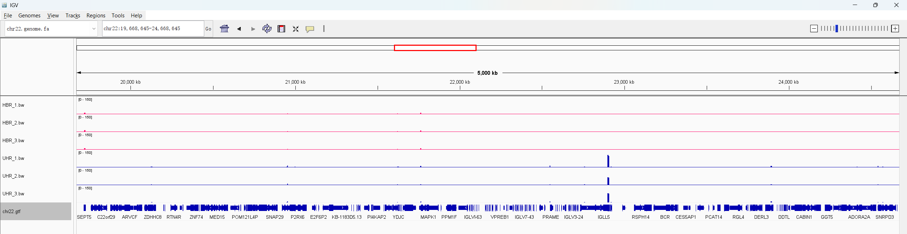
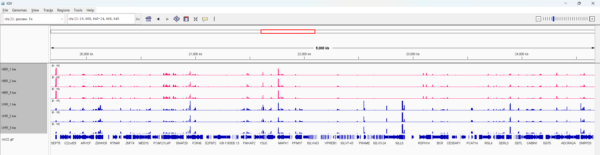
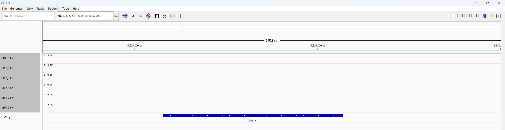
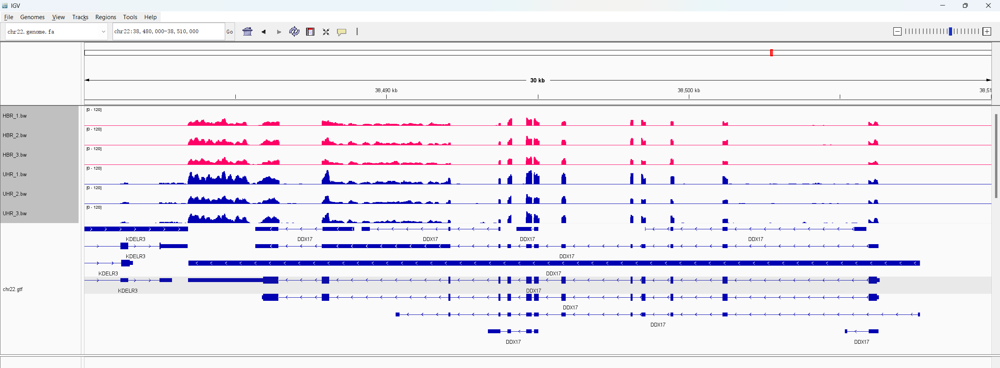
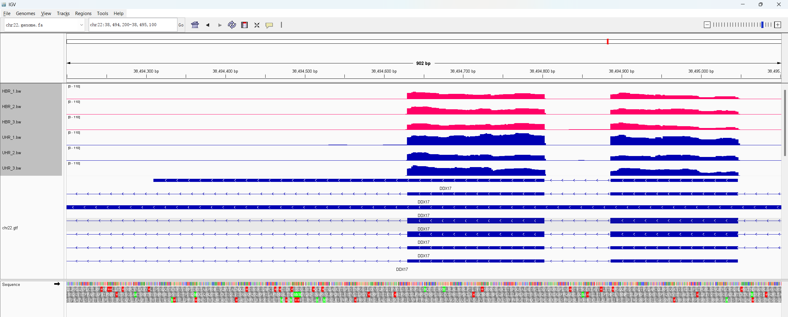
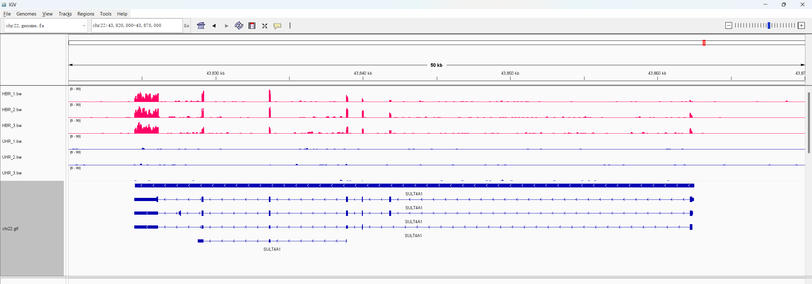
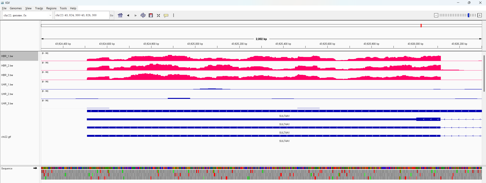

# RNA-seq expression in human brain and universal reference samples

This analysis compares RNA-seq coverage on chromosome 22 between three Human
Brain Reference replicates (`HBR_1`–`HBR_3`) and three Universal Human
Reference replicates (`UHR_1`–`UHR_3`). The UHR material is a mixture of RNA
from ten cancer cell lines.

## IGV setup

I loaded `fasta/chr22.genome.fa`, the six original coverage tracks in `bw/`,
and `gtf/chr22.gtf`. HBR tracks are pink and UHR tracks are blue. Within each
panel, all six coverage tracks use the same linear data range so their heights
can be compared directly.

## Genome-wide patterns and replicate consistency

Region: `chr22:19,668,645-24,668,645`  
Data range: `0-150`

RNA-seq coverage is concentrated in discrete transcribed regions rather than
distributed continuously along the chromosome. Replicates within HBR and UHR
show similar signal locations and relative patterns. The two sample types
differ at several loci; for example, the strong signal near 22.9 Mb is present
in all three UHR samples but is much weaker in HBR.

The same region is shown below with a lower common upper limit to reveal weaker
coverage patterns. Values above 15 are clipped in this panel.

Region: `chr22:19,668,645-24,668,645`  
Data range: `0-15` (clipped)

The lower-range view confirms that the three replicates within each sample
type generally reproduce the same covered regions. Replicate heights are not
identical, but the major spatial patterns are consistent.

## A gene not expressed in these samples

Gene: `OR11H1`  
Region: `chr22:15,527,500-15,530,000`  
Data range: `0-10`

`OR11H1` has no visible coverage in any of the six samples and is therefore
not detectably expressed in this dataset.

## A gene strongly expressed in all samples

Gene: `DDX17`  
Region: `chr22:38,480,000-38,510,000`  
Data range: `0-30` (clipped)

`DDX17` is strongly expressed in all six samples, with coverage across
multiple annotated exons. It has several overlapping annotated transcripts.
The shared exon coverage confirms expression of the gene, but these short
reads do not uniquely identify one complete transcript. Transcripts lacking
support at an alternative exon can sometimes be excluded, whereas transcripts
composed mainly of shared exons remain indistinguishable. Coverage above 30 is
clipped in this overview to make the exon patterns visible.

Representative exons: `chr22:38,494,200-38,495,100`  
Data range: `0-110`

Across these exons, typical coverage is approximately 16-18 reads in HBR and
approximately 19-32 reads in UHR, with local peaks of about 60-110 reads.
Thus, `DDX17` is strongly expressed in both sample types.

## A gene differentially expressed between HBR and UHR

Gene: `SULT4A1`  
Region: `chr22:43,820,000-43,870,000`  
Data range: `0-30`

All three HBR replicates show coverage across multiple `SULT4A1` exons,
whereas all three UHR replicates have little or no coverage over the same
regions. `SULT4A1` is therefore upregulated in HBR relative to UHR.

Representative exon: `chr22:43,824,300-43,826,300`  
Data range: `0-30`

Coverage over this exon is approximately 13-14 reads in the HBR replicates
and is close to zero in UHR. Across the exon, the visual difference is
approximately 100-fold. This is an approximate coverage-based fold change
rather than a formal differential-expression estimate.

The difference is unlikely to be a random fluctuation because the same pattern
is present in all three replicates and across multiple exons: every HBR sample
has clear coverage, while every UHR sample remains consistently low.

