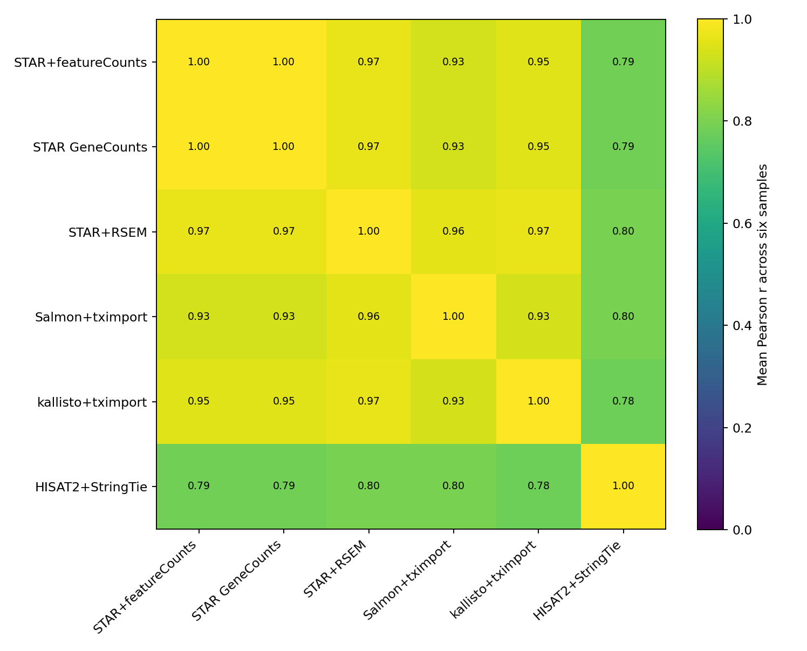
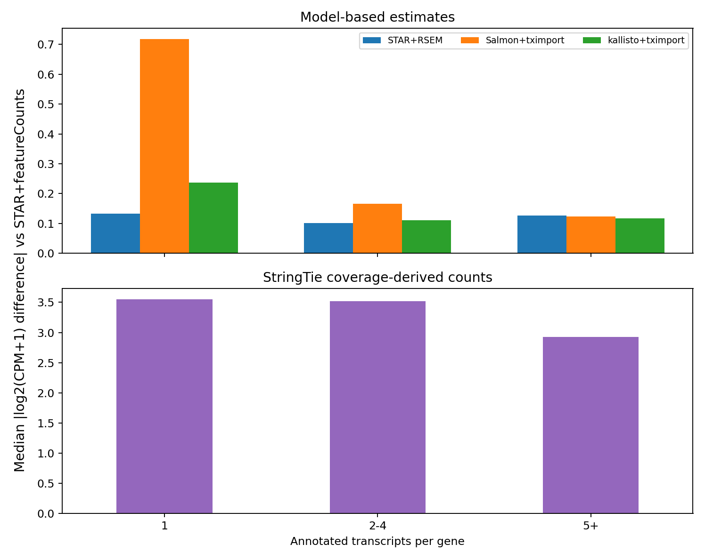

# Comparison of six chr22 RNA-seq quantification pipelines

Gene correlations use 1336 genes shared by all six matrices; transcript correlations use 4251 transcripts shared by the four methods that estimate transcripts. For each method and sample, counts were divided by the total reported chr22 counts, then transformed as log1p(CPM). This is a descriptive within-chromosome comparison.

## What changed across methods?

STAR GeneCounts and STAR+featureCounts gave identical gene counts for all genes and samples. Mean gene-level Pearson correlations with STAR+featureCounts were STAR+RSEM 0.966, Salmon+tximport 0.931, kallisto+tximport 0.951, HISAT2+StringTie 0.786 across six samples.

Among the 452 genes with at least 5 direct counts in one sample, the corresponding correlations were STAR+RSEM 0.965, Salmon+tximport 0.877, kallisto+tximport 0.949, HISAT2+StringTie 0.746. Including many all-zero genes makes some methods look more similar.

At transcript level, RSEM versus kallisto averaged 0.884, RSEM versus Salmon 0.713, and Salmon versus kallisto 0.680. These lower transcript correlations are consistent with different allocation of reads among isoforms; they do not by themselves identify which estimate is correct.

## Low counts and isoforms

The mean number of genes with at least 1 but fewer than 10 reported counts per sample was:

| Method | Genes with 1 to <10 counts |
|---|---:|
| STAR+featureCounts | 248.3 |
| STAR GeneCounts | 248.3 |
| STAR+RSEM | 215.5 |
| Salmon+tximport | 164.5 |
| kallisto+tximport | 240.2 |
| HISAT2+StringTie | 8.5 |

The count types differ: direct integers, model-estimated counts, and StringTie coverage-derived approximations. These are detection summaries, not a sensitivity ranking.

For the isoform comparison I kept 452 shared genes with at least 5 STAR+featureCounts reads in one sample. The plot shows median absolute log2(CPM+1) differences from STAR+featureCounts by number of annotated transcripts. The pattern is descriptive; isoform count alone does not establish the cause of a difference.

For SULT4A1 in HBR_1, the gene totals from RSEM, Salmon, and kallisto are STAR+RSEM 283.0, Salmon+tximport 284.0, kallisto+tximport 288.0 counts, but their allocation to transcripts differs:

| Transcript | RSEM | Salmon | kallisto |
|---|---:|---:|---:|
| ENST00000330884.8 | 99.1 | 0.0 | 87.9 |
| ENST00000422525.1 | 0.0 | 35.5 | 15.0 |
| ENST00000432404.5 | 181.1 | 248.5 | 183.6 |
| ENST00000475131.1 | 2.9 | 0.0 | 1.5 |

This shows why similar gene totals do not guarantee similar isoform estimates.

## Cross-check with IGV

For the STAR+featureCounts matrix, the genes examined in the earlier IGV analysis have these count ranges:

| Gene | HBR | UHR |
|---|---:|---:|
| OR11H1 | 0–0 | 0–0 |
| DDX17 | 1,528–1,792 | 1,801–2,801 |
| SULT4A1 | 286–335 | 3–6 |

These values agree with the broad visual pattern recorded in the earlier IGV analysis.

## Runtime and memory

| Route | Mean seconds per sample | Mean maximum stage RAM (MiB) |
|---|---:|---:|
| STAR+featureCounts | 137.7 | 946 |
| STAR GeneCounts | 137.5 | 946 |
| STAR+RSEM | 142.4 | 946 |
| Salmon+tximport | 1.0 | 352 |
| kallisto+tximport | 1.8 | 112 |
| HISAT2+StringTie | 1.3 | 77 |

These are runs on one machine using only the course chr22 subset. Index-building time is separate, and STAR alignment is shared across three routes. The memory number is the largest single stage for each sample.

Full tables: [gene matrix summary](summary.tsv), [gene correlations](correlations.tsv), [expressed-gene correlations](correlations_expressed.tsv), [transcript correlations](transcript_correlations.tsv), [IGV genes](igv_examples.tsv), [per-gene differences](gene_differences.tsv), [isoform group sizes](isoform_complexity_n.tsv), [runtime and memory](runtime_memory.tsv), [index costs](index_cost.tsv).
